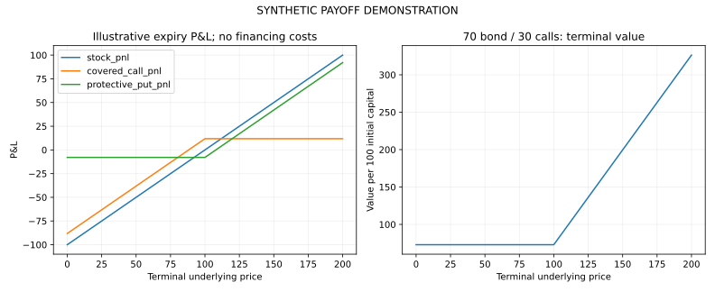

# Derivatives and Portfolio Risk Lab

European option pricing, implied volatility, numerical valuation and hedging payoffs with independently checked illustrative scenarios.

**Research question:** How do analytical and numerical option-pricing methods compare, and how do common hedging structures change terminal payoffs?

**Public edition:** New reconstruction of the core valuation and payoff methods using illustrative inputs.

**8 functional checks passed locally**, plus a complete demonstration run.

## What you can inspect

- Price European calls and puts with Black-Scholes and continuous dividend yield.
- Compute delta and recover implied volatility subject to no-arbitrage bounds.
- Cross-check analytical prices with CRR binomial and seeded Monte Carlo valuation.
- Compare covered-call and protective-put expiry P&L.
- Inspect the terminal payoff of a 70-percent bond and 30-percent call allocation.

## Results preview

All values below are synthetic or illustrative workflow results.



| Calculation | Illustrative value |
| --- | --- |
| Analytical call | 9.55626 |
| Analytical put | 10.4391 |
| Binomial call | 9.55194 |
| Monte Carlo call | 9.57773 |
| Monte Carlo standard error | 0.0529321 |
| Recovered volatility | 0.25 |

The numerical and analytical call estimates are close under the common assumed model. Simulation error is distinct from uncertainty about the model itself.

## Run the example

Use Python 3.12. From this project's directory:

```bash
python -m pip install -r requirements.txt
python -m unittest discover -v
python pricing.py --output demo_output
```

For an isolated environment, run `python -m venv .venv` first. Activate it with `source .venv/bin/activate` on Linux/macOS or `.venv\Scripts\activate` on Windows. The standard example runs offline after dependencies are installed.

The [notebook walkthrough](notebooks/01_results_walkthrough.ipynb) explains the saved outputs. Exact command-line options appear in [CLI.txt](docs/CLI.txt).

## Documentation

| Guide | What it covers |
| --- | --- |
| [Methods](docs/METHODS.md) | Formulas, assumptions and interpretation |
| [Data dictionary](docs/DATA_DICTIONARY.md) | Variables, units and validation rules |
| [Results](docs/RESULTS.md) | Actual bundled output and how to read it |
| [Reproducibility](REPRODUCIBILITY.md) | Commands, checks and the recorded environment |
| [Provenance and attribution](docs/PROVENANCE.md) | Historical context, reconstruction and contribution |
| [Roadmap](docs/ROADMAP.md) | Specific extensions, with unfinished work labelled |
| [References](docs/REFERENCES.md) | Method documentation and source links |

## Limits of interpretation

- European exercise, constant rates and constant volatility are simplifying assumptions.
- Expiry P&L subtracts nominal initial outlay and omits financing costs.
- No transaction costs, bid-ask spread or market calibration is included.
- A 70-percent bond allocation is not full principal protection.

## Contribution and research context

Documented June-July 2024 coursework on options, volatility, hedging, equity analysis and structured products.

Arinjai Das worked on the documented quantitative-finance coursework. The public reconstruction implements and checks the core methods; it is not a recovered copy of the earlier multi-stock scripts or an investment track record.

**Skills demonstrated:** Python, quantitative finance, option pricing, implied volatility, Monte Carlo, hedging, numerical methods.

[Portfolio](https://github.com/arinjaidas/My-Projects) · [GitHub profile](https://github.com/arinjaidas)
